# User:designer

## General informations

**Name**:  Designer

**Preferred date format**: MM/DD/YYYY

**Preferred number format**: CD


# Module: SimFeatures

## Relationships

```mermaid
erDiagram
    FtActionRedirect {
        id row_id PK
        string ftActCode PK
        date ftActDate
        string ftActDocument
        image ftActImage
        enum ftActState
        string ftActMultiDocs
    }
    FtActions {
        id row_id PK
        string ftActCode PK
        date ftActDate
        string ftActDocument
        image ftActImage
        enum ftActState
        string ftActMultiDocs
    }
    FtAttributes {
        id row_id PK
        string ftAttrCode PK
        string ftAttrShortText
        string ftAttrValidatedText
        longString ftAttrLongText
        longString ftAttrLongTextEditor
        longString ftAttrLongTextMarkdown
        longString ftAttrLongTextGrid
        longString ftAttrLongTextGridSource
        html ftAttrHtml
        int ftAttrInteger
        int ftAttrIntegerMonetary
        int ftAttrIntegerPercentage
        int ftAttrIntegerEuro
        int ftAttrIntegerProgressBar
        int ftAttrIntegerStars
        int ftAttrIntegerSlider
        float ftAttrDecimal
        float ftAttrDecimalMonetary
        float ftAttrDecimalPercentage
        float ftAttrDecimalEuro
        float ftAttrDecimalProgressBar
        float ftAttrDecimalCalculator
        date ftAttrDate
        date ftAttrDateToMonth
        date ftAttrDateToYear
        time ftAttrTime
        time ftAttrTimeToMinute
        time ftAttrTimeToHour
        datetime ftAttrDateTime
        datetime ftAttrDateTimeToMinute
        datetime ftAttrDateTimeToHour
        datetime ftAttrDateTimeToDay
        datetime ftAttrDateTimeToMonth
        datetime ftAttrDateTimeToYear
        enum ftAttrEnum
        enum ftAttrEnumRadioHorizontal
        enum ftAttrEnumCheckboxHorizontal
        enum ftAttrEnumCheckboxVertical
        enum ftAttrEnumRadioVertical
        enum ftAttrEnumPillbox
        enumMulti ftAttrEnumMulti
        enumMulti ftAttrEnumMultiCheckboxHorizontal
        enum ftAttrEnumMultiCheckboxVertical
        enumMulti ftAttrEnumMultiRadioHorizontal
        enum ftAttrEnumMultiRadioVertical
        enumMulti ftAttrEnumMultiPillbox
        boolean ftAttrBoolean
        boolean ftAttrBooleanCheckbox
        boolean ftAttrBooleanCombobox
        boolean ftAttrBooleanSlide
        string ftAttrDocument
        string ftAttrDocumentName
        string ftAttrDocumentMultiBox
        string ftAttrDocumentMultiList
        string ftAttrExternalFile
        image ftAttrImage
        url ftAttrUrl
        email ftAttrEmail
        password ftAttrPassword
        phone ftAttrPhoneNumber
        color ftAttrColor
        geocoords ftAttrGeographicalCoordinates
        notepad ftAttrNotepad
        notepad ftAttrNotepadUserActivities
        date ftAttrDateStart
        date ftAttrDateEnd
        html ftAttrHtmlReadOnly
        image ftAttrSignaturePad
    }
    FtCustomUser {
        id row_id PK
        id usr_home_id FK
        id usr_scope_id FK
        image usr_image_id
        string usr_login PK
        string usr_first_name
        string usr_last_name
        enum usr_lang
        email usr_email
        phone usr_cell_num
        enum usr_active
        enum ftUsrType
    }
    FtGuidedObject {
        id row_id PK
        string ftGoUserKey PK
    }
    FtHistory {
        id row_id PK
        string ftHistCode PK
        float ftHistDecimal
        datetime ftHistDateAndTime
        enum ftHistEnumeration
        enumMulti ftHistMultipleEnumeration
        boolean ftHistBoolean
        string ftHistDocument
        string ftHistMultiDoc
    }
    FtHistoryHistoric {
        id row_id PK
        id row_ref_id FK
        html row_diff
        string ftHistCode PK
        float ftHistDecimal
        datetime ftHistDateAndTime
        enum ftHistEnumeration
        enumMulti ftHistMultipleEnumeration
        boolean ftHistBoolean
        string ftHistDocument
        string ftHistMultiDoc
    }
    FtListItem {
        id row_id PK
        string ftLstCode PK
        int ftLstOrder
        enum ftLstType
        html ftLstDescription
        image ftLstImage
    }
    FtListOrdering {
        id row_id PK
        int ftLoOrder
        string ftLoLabel PK
    }
    FtM2m {
        id row_id PK
        id ftM2mId FK
        id ftM2mcId FK
    }
    FtM2mChild {
        id row_id PK
        string ftM2mcCode PK
    }
    FtNotification {
        id row_id PK
        string ftNtfCode PK
    }
    FtO2mChild {
        id row_id PK
        id ftO2mcO2mId FK
        string ftO2mcCode PK
    }
    FtObjInlineChild {
        id row_id PK
        id ftObjInlineChildParentId FK
        string ftObjInlineName
        datetime ftObjInlineDateTime
        float ftObjInlineNumber
        string ftObjInlineDocument
        string ftObjInlineDocMulti
        image ftObjInlineImage
    }
    FtObjInlineParent {
        id row_id PK
        string ftObjInlineParentName PK
        longString ftObjInlineParentDescription
    }
    FtPublications {
        id row_id PK
        string ftPubCode PK
        longString ftPubHtml
        string ftPubFile
    }
    FtReflexiveMany {
        id row_id PK
        string ftRxmCode PK
        id ftRxmId
    }
    FtRelationshipM2m {
        id row_id PK
        string ftM2mCode PK
    }
    FtRelationshipO2m {
        id row_id PK
        string ftO2mCode PK
        string ftO2mDescription
    }
    FtRxmLink {
        id row_id PK
        id ftRxlRxm1 FK
        id ftRxlRxm2 FK
    }
    FtSearch {
        id row_id PK
        id ftSchSrfId FK
        string ftSchCode PK
        date ftSchDate
        geocoords ftSchCoordinates
        string ftSchFormField
    }
    FtSearchReference {
        id row_id PK
        string ftSrfCode PK
    }
    FtSelectObject {
        id row_id PK
        string ftSlcField1
        string ftSlcField2
        date ftSlcFieldDt
    }
    FtStates {
        id row_id PK
        int ftStOrder
        string ftStCode PK
        enum ftStState
    }
    FtStatesHistoric {
        id row_id PK
        id row_ref_id FK
        html row_diff
        string ftStCode PK
        enum ftStState
    }
    FtTag {
        id row_id PK
        string ftTagName PK
    }
    FtTaggedObject {
        id row_id PK
        string ftTgoCode PK
        string ftTgoStatus
    }
    FtTgoTag {
        id row_id PK
        id ftTgotagTgoId FK
        id ftTgotagTagId FK
    }
    ViewHome |o--o{ FtCustomUser : "usr_home_id"
    Scope |o--o{ FtCustomUser : "usr_scope_id"
    FtHistory ||--o{ FtHistoryHistoric : "row_ref_id"
    FtRelationshipM2m ||--o{ FtM2m : "ftM2mId"
    FtM2mChild ||--o{ FtM2m : "ftM2mcId"
    FtRelationshipO2m ||--o{ FtO2mChild : "ftO2mcO2mId"
    FtObjInlineParent ||--o{ FtObjInlineChild : "ftObjInlineChildParentId"
    FtReflexiveMany ||--o{ FtRxmLink : "ftRxlRxm1"
    FtReflexiveMany ||--o{ FtRxmLink : "ftRxlRxm2"
    FtSearchReference |o--o{ FtSearch : "ftSchSrfId"
    FtStates ||--o{ FtStatesHistoric : "row_ref_id"
    FtTaggedObject ||--o{ FtTgoTag : "ftTgotagTgoId"
    FtTag ||--o{ FtTgoTag : "ftTgotagTagId"

```



## Domains

Domains organize the application's main navigation menu. Each domain groups the objects, processes, and external pages accessible to users from it. Domains can be nested: a domain may have a parent domain.

```yaml
FtDomain:
  parent: ~
  items:
    - name: FtAttributes
      type: object
    - name: FtListItem
      type: object
    - name: FtCustomUser
      type: object
    - name: FtStates
      type: object
    - name: FtRelationshipO2m
      type: object
    - name: FtRelationshipM2m
      type: object
    - name: FtM2mChild
      type: object
    - name: FtReflexiveMany
      type: object
    - name: FtTaggedObject
      type: object
    - name: FtTag
      type: object
    - name: FtSelectObject
      type: object
    - name: FtTestMermaid
      type: external
    - name: FtNotification
      type: object
    - name: FtActions
      type: object
    - name: FtPublications
      type: object
    - name: FtSearch
      type: object
    - name: FtListOrdering
      type: object
    - name: FtGuidedObject
      type: object
    - name: FtHistory
      type: object
FtDomainInline:
  parent: FtDomain
  items:
    - name: FtObjInlineParent
      type: object
    - name: FtObjInlineChild
      type: object
```

## System parameters

```yaml
WEBPUSH: "yes"
```

## FtActionRedirect

```yaml
label: Action redirect
table: ft_actions
```

_No description._

### Relationships

```yaml
belongs_to: []
has_many: []
```

### Fields

```yaml
auto:
  ftActCode: char(100)  # [unique key] [col:ft_act_code]

required:
  ftActState: enum(1) using FT_ACT_STATE list  # [col:ft_act_state] [default:A]

optional:
  ftActDate: date  # [col:ft_act_date]
  ftActDocument: document  # [col:ft_act_document]
  ftActImage: image  # [col:ft_act_image]
  ftActMultiDocs: document  # [col:ft_act_multi_docs]

```

### Enumerations

```yaml
FT_ACT_STATE:
  A: Step A
  B: Step B
```

### State transitions (ftActState)

```yaml
A: [B]
B: [A]
```

---

## FtActions

```yaml
label: Action
table: ft_actions
```

_No description._

### Relationships

```yaml
belongs_to: []
has_many: []
```

### Fields

```yaml
auto:
  ftActCode: char(100)  # [unique key] [col:ft_act_code]

required:
  ftActState: enum(1) using FT_ACT_STATE list  # [col:ft_act_state] [default:A]

optional:
  ftActDate: date  # [col:ft_act_date]
  ftActDocument: document  # [col:ft_act_document]
  ftActImage: image  # [col:ft_act_image]
  ftActMultiDocs: document  # [col:ft_act_multi_docs]

```

### Enumerations

```yaml
FT_ACT_STATE:
  A: Step A
  B: Step B
```

### State transitions (ftActState)

```yaml
A: [B]
B: [A]
```

### Actions

```yaml
ActAskFields:
ActAsync:
ActConfirmFields:
```

### Hooks

```yaml
askAction: ~
confirmAction: ~
initAction: ~
getTargetObject: |
  Redirect hook to FtActionRedirect inherited object 
  to test the redirect feature of actions
  and bulk update/reorder on a list of objects
```

---

## FtAttributes

```yaml
label: Attributes
table: ft_attributes
```

Object showcasing all the possible attributes

### Relationships

```yaml
belongs_to: []
has_many: []
```

### Fields

```yaml
auto:
  ftAttrLongTextGridSource: text(4000)
  ftAttrHtmlReadOnly: html(100000)  # [col:ft_attr_html_read_only]

required:
  ftAttrCode: char(10)  # [unique key] [col:ft_attr_code]

optional:
  ftAttrShortText: char(255)  # [col:ft_attr_short_text]
  ftAttrValidatedText: regexp(250)  # [col:ft_attr_validated_text]
  ftAttrLongText: text(4000)  # [col:ft_attr_long_text]
  ftAttrLongTextEditor: text(4000)  # [col:ft_attr_long_text_editor]
  ftAttrLongTextMarkdown: text(4000)  # [col:ft_attr_long_text_markdown]
  ftAttrLongTextGrid: text(4000)  # [col:ft_attr_long_text_grid]
  ftAttrHtml: html(100000)  # [col:ft_attr_html]
  ftAttrInteger: int(5)  # [col:ft_attr_integer]
  ftAttrIntegerMonetary: int(5)  # [col:ft_attr_integer_monetary]
  ftAttrIntegerPercentage: int(3)  # [col:ft_attr_integer_percentage]
  ftAttrIntegerEuro: int(5)  # [col:ft_attr_integer_euro]
  ftAttrIntegerProgressBar: int(5)  # [col:ft_attr_integer_progress_bar]
  ftAttrIntegerStars: int(1)  # [col:ft_attr_integer_stars]
  ftAttrIntegerSlider: int(2)  # [col:ft_attr_integer_slider]
  ftAttrDecimal: float(10, 2)  # [col:ft_attr_decimal]
  ftAttrDecimalMonetary: float(10, 2)  # [col:ft_attr_decimal_monetary]
  ftAttrDecimalPercentage: float(6, 4)  # [col:ft_attr_decimal_percentage]
  ftAttrDecimalEuro: float(10, 2)  # [col:ft_attr_decimal_euro]
  ftAttrDecimalProgressBar: float(15, 4)  # [col:ft_attr_decimal_progress_bar]
  ftAttrDecimalCalculator: float(10, 2)  # [col:ft_attr_decimal_calculator]
  ftAttrDate: date  # [col:ft_attr_date]
  ftAttrDateToMonth: date  # [col:ft_attr_date_to_month]
  ftAttrDateToYear: date  # [col:ft_attr_date_to_year]
  ftAttrTime: time  # [col:ft_attr_time]
  ftAttrTimeToMinute: time  # [col:ft_attr_time_to_minute]
  ftAttrTimeToHour: time  # [col:ft_attr_time_to_hour]
  ftAttrDateTime: datetime  # [col:ft_attr_date_time]
  ftAttrDateTimeToMinute: datetime  # [col:ft_attr_date_time_to_minute]
  ftAttrDateTimeToHour: datetime  # [col:ft_attr_date_time_to_hour]
  ftAttrDateTimeToDay: datetime  # [col:ft_attr_date_time_to_day]
  ftAttrDateTimeToMonth: datetime  # [col:ft_attr_date_time_to_month]
  ftAttrDateTimeToYear: datetime  # [col:ft_attr_date_time_to_year]
  ftAttrEnum: enum(10) using FTATTRENUM list  # [col:ft_attr_enum]
  ftAttrEnumRadioHorizontal: enum(3) using FTATTRENUMRADIOHORIZONTAL list  # [col:ft_attr_enum_radio_horizontal]
  ftAttrEnumCheckboxHorizontal: enum(3) using FTATTRENUMCHECKBOXHORIZONTAL list  # [col:ft_attr_enum_checkbox_horizontal]
  ftAttrEnumCheckboxVertical: enum(3) using FTATTRENUMCHECKBOXVERTICAL list  # [col:ft_attr_enum_checkbox_vertical]
  ftAttrEnumRadioVertical: enum(3) using FTATTRENUMRADIOVERTICAL list  # [col:ft_attr_enum_radio_vertical]
  ftAttrEnumPillbox: enum(100) using FTATTRENUMPILLBOX list  # [col:ft_attr_enum_pillbox]
  ftAttrEnumMulti: multi(100) using FTATTRENUMMULTI list  # [col:ft_attr_enum_multi]
  ftAttrEnumMultiCheckboxHorizontal: multi(5) using FTATTRENUMMULTICHECKBOXHORIZONTAL list  # [col:ft_attr_enum_multi_checkbox_horizontal]
  ftAttrEnumMultiCheckboxVertical: enum(100) using FTATTRENUMMULTICHECKBOXVERTICAL list  # [col:ft_attr_enum_multi_checkbox_vertical]
  ftAttrEnumMultiRadioHorizontal: multi(5) using FTATTRENUMMULTIRADIOHORIZONTAL list  # [col:ft_attr_enum_multi_radio_horizontal]
  ftAttrEnumMultiRadioVertical: enum(3) using FTATTRENUMMULTIRADIOVERTICAL list  # [col:ft_attr_enum_multi_radio_vertical]
  ftAttrEnumMultiPillbox: multi(5) using FTATTRENUMMULTIPILLBOX list  # [col:ft_attr_enum_multi_pillbox]
  ftAttrBoolean: boolean  # [col:ft_attr_boolean]
  ftAttrBooleanCheckbox: boolean  # [col:ft_attr_boolean_checkbox]
  ftAttrBooleanCombobox: boolean  # [col:ft_attr_boolean_combobox]
  ftAttrBooleanSlide: boolean  # [col:ft_attr_boolean_slide]
  ftAttrDocument: document  # [col:ft_attr_document]
  ftAttrDocumentName: document  # [col:ft_attr_document_name]
  ftAttrDocumentMultiBox: document  # [col:ft_attr_document_multi_box]
  ftAttrDocumentMultiList: document  # [col:ft_attr_document_multi_list]
  ftAttrExternalFile: extfile(100)  # [col:ft_attr_external_file]
  ftAttrImage: image  # [col:ft_attr_image]
  ftAttrUrl: url(500)  # [col:ft_attr_url]
  ftAttrEmail: email(255)  # [col:ft_attr_email]
  ftAttrPassword: password(100)  # [col:ft_attr_password]
  ftAttrPhoneNumber: phone(100)  # [col:ft_attr_phone_number]
  ftAttrColor: color  # [col:ft_attr_color]
  ftAttrGeographicalCoordinates: geocoords  # [col:ft_attr_geographical_coordinates] [default:48.8753213,2.3455624]
  ftAttrNotepad: notepad(2147483647)  # [col:ft_attr_notepad]
  ftAttrNotepadUserActivities: notepad(2147483647)  # [col:ft_attr_notepad_user_activities]
  ftAttrDateStart: date  # [col:ft_attr_date_start]
  ftAttrDateEnd: date  # [col:ft_attr_date_end]
  ftAttrSignaturePad: image  # [col:ft_attr_signature_pad]

```

### Enumerations

```yaml
FTATTRENUM:
  A: code A
  B: code B
  C: code C

FTATTRENUMRADIOHORIZONTAL:
  A: code A
  B: code B
  C: code C

FTATTRENUMCHECKBOXHORIZONTAL:
  A: code A
  B: code B
  C: code C

FTATTRENUMCHECKBOXVERTICAL:
  A: code A
  B: code B
  C: code C

FTATTRENUMRADIOVERTICAL:
  A: code A
  B: code B
  C: code C

FTATTRENUMPILLBOX:
  A: code A
  B: code B
  C: code C

FTATTRENUMMULTI:
  A: code A
  B: code B
  C: code C

FTATTRENUMMULTICHECKBOXHORIZONTAL:
  A: code A
  B: code B
  C: code C

FTATTRENUMMULTICHECKBOXVERTICAL:
  A: code A
  B: code B
  C: code C

FTATTRENUMMULTIRADIOHORIZONTAL:
  A: code A
  B: code B
  C: code C

FTATTRENUMMULTIRADIOVERTICAL:
  A: code A
  B: code B
  C: code C

FTATTRENUMMULTIPILLBOX:
  A: code A
  B: code B
  C: code C
```

### Hooks

```yaml
preSave: ~
initUpdate: ~
```

---

## FtCustomUser

```yaml
label: Custom User
table: m_user
```

_No description._

### Relationships

```yaml
belongs_to:
  - ViewHome (usr_home_id, optional)  # deprecated / use usr_scope_id.viw_home_id
  - Scope (usr_scope_id, optional)
has_many: []
```

### Fields

```yaml
required:
  usr_login: regexp(100)  # Login [unique key] [personal] [col:usr_login]
  usr_lang: enum(3) using LANG list  # Language [personal] [col:usr_lang] [default:[LANG]]
  ftUsrType: enum(10) using FTUSRTYPE list  # [col:ft_usr_type] [default:FT_ADMIN]

optional:
  usr_image_id: image  # Picture [personal] [col:usr_image_id]
  usr_first_name: char(50)  # First name [personal] [col:usr_first_name]
  usr_last_name: char(50)  # Last name [personal] [col:usr_last_name]
  usr_email: email(100)  # Email address [personal] [col:usr_email]
  usr_cell_num: phone(20)  # Mobile/cellular phone number [personal] [col:usr_cell_num]
  usr_active: enum(1) using USER_STATUS list  # [col:usr_active] [default:0]

referenced:
  viw_name: char(100)  # [col:viw_name]
  sco_name: char(100)  # [col:sco_name]
  sco_home_id: id  # [col:sco_home_id]
  viw_name: char(100)  # [col:viw_name]
  mdl_name: regexp(100)  # Module name [col:mdl_name]

```

### Enumerations

```yaml
LANG:
  ENU: English language
  FRA: French language

USER_STATUS:
  0: Inactive
  1: Active
  2: Pending
  3: Web services only

FTUSRTYPE:
  FT_ADMIN: SimFeatures Admin
  FT_READ: SimFeatures Reader
```

### State transitions (usr_active)

```yaml
0: [1, 2, 3]
1: [0, 3]
2: [0, 1]
3: [0, 1]
```

### Hooks

```yaml
postSave: ~
preValidate: ~
postLoad: ~
postCreate: ~
preDelete: ~
getUserKeyLabel: ~
postValidate: ~
initUpdateAll: ~
isActionEnable: ~
isDeleteEnable: ~
isCopyEnable: ~
getMappedFilePath: ~
totpQRCode: ~
anonymize: ~
initCreate: ~
initUpdate: ~
initCopy: ~
resetPassword: ~
deletePrefs: ~
createUserToken: ~
postDelete: ~
postUpdate: ~
preCreate: ~
preUpdate: ~
getMappedExportPath: ~
canReference: ~
isUpdateEnable: ~
postSearch: ~
preSearch: ~
postSelect: ~
```

---

## FtGuidedObject

```yaml
label: Guided object
table: ft_guided_object
```

[Object with user guide](https://docs.simplicite.io/versions/release-notes/v6-3/#ui-guides)

### Relationships

```yaml
belongs_to: []
has_many: []
```

### Fields

```yaml
required:
  ftGoUserKey: char(100)  # [unique key] [col:ft_go_user_key]

```

---

## FtHistory

```yaml
label: History
table: ft_history
```

History object

### Relationships

```yaml
belongs_to: []
has_many:
  - FtHistoryHistoric via row_ref_id [on delete: cascade, visible]
```

### Fields

```yaml
auto:
  ftHistCode: char(100)  # [unique key] [col:ft_hist_code]

optional:
  ftHistDecimal: float(100, 2)  # [col:ft_hist_decimal]
  ftHistDateAndTime: datetime  # [col:ft_hist_date_and_time]
  ftHistEnumeration: enum(100) using FT_HIST_ENUMERATION list  # [col:ft_hist_enumeration]
  ftHistMultipleEnumeration: multi(100) using FT_HIST_MULTIPLE_ENUMERATION list  # [col:ft_hist_multiple_enumeration]
  ftHistBoolean: boolean  # [col:ft_hist_boolean]
  ftHistDocument: document  # [col:ft_hist_document]
  ftHistMultiDoc: document  # [col:ft_hist_multi_doc]

```

### Enumerations

```yaml
FT_HIST_ENUMERATION:
  A: code A
  B: code B
  C: code C

FT_HIST_MULTIPLE_ENUMERATION:
  A: code A
  B: code B
  C: code C
```

---

## FtHistoryHistoric

```yaml
label: Historic
table: ft_history_hist
```

_No description._

History of FtHistory.

### Relationships

```yaml
belongs_to:
  - FtHistory (row_ref_id, required, on parent delete: cascade)  # record row id
has_many: []
```

### Fields

```yaml
referenced:
  ftHistCode: char(100)  # [col:ft_hist_code]

tracked:
  row_diff: html(2000000)  # Computed differences between a row and its previous sibling row of the same object.

To enable it:
- add the `row_diff` field to the object
- call `setRowDiff(true)` in `postLoad`

It is enabled by default on the history panel of the parent object.
  ftHistCode: char(100)  # [unique key] [col:ft_hist_code]
  ftHistDecimal: float(100, 2)  # [col:ft_hist_decimal]
  ftHistDateAndTime: datetime  # [col:ft_hist_date_and_time]
  ftHistEnumeration: enum(100) using FT_HIST_ENUMERATION list  # [col:ft_hist_enumeration]
  ftHistMultipleEnumeration: multi(100) using FT_HIST_MULTIPLE_ENUMERATION list  # [col:ft_hist_multiple_enumeration]
  ftHistBoolean: boolean  # [col:ft_hist_boolean]
  ftHistDocument: document  # [col:ft_hist_document]
  ftHistMultiDoc: document  # [col:ft_hist_multi_doc]
```

### Enumerations

```yaml
FT_HIST_ENUMERATION:
  A: code A
  B: code B
  C: code C

FT_HIST_MULTIPLE_ENUMERATION:
  A: code A
  B: code B
  C: code C
```

---

## FtListItem

```yaml
label: Lists
table: ft_list_item
```

_No description._

### Relationships

```yaml
belongs_to: []
has_many: []
```

### Fields

```yaml
auto:
  ftLstCode: char(100)  # [unique key] [col:ft_lst_code]

optional:
  ftLstOrder: int(10)  # [col:ft_lst_order]
  ftLstType: enum(10) using FT_LST_TYPE list  # [col:ft_lst_type]
  ftLstDescription: html(5000)  # [col:ft_lst_description]
  ftLstImage: image  # [col:ft_lst_image]

```

### Enumerations

```yaml
FT_LST_TYPE:
  A: code A
  B: code B
  C: code C
```

### Description (from code)

Business object FtListItem

### Hooks

```yaml
postReorder: ~
preReorder: ~
```

---

## FtListOrdering

```yaml
label: List ordering
table: ft_list_ordering
```

[Quick list ordering](https://docs.simplicite.io/versions/release-notes/v6-3/#quick-list-ordering)

### Relationships

```yaml
belongs_to: []
has_many: []
```

### Fields

```yaml
required:
  ftLoLabel: char(100)  # [unique key] [col:ft_lo_label]

optional:
  ftLoOrder: int(100)  # [col:ft_lo_order]

```

---

## FtM2m

```yaml
label: N/N
table: ft_m2m
```

_No description._

### Relationships

```yaml
belongs_to:
  - FtRelationshipM2m (ftM2mId, required, on parent delete: cascade)
  - FtM2mChild (ftM2mcId, required, on parent delete: cascade)
has_many: []
```

### Fields

```yaml
referenced:
  ftM2mCode: char(100)  # [col:ft_m2m_code]
  ftM2mcCode: char(100)  # [col:ft_m2mc_code]

```

### Hooks

```yaml
postCreate: ~
```

---

## FtM2mChild

```yaml
label: Child (many to many)
table: ft_m2m_child
```

_No description._

### Relationships

```yaml
belongs_to: []
has_many:
  - FtM2m via ftM2mcId [on delete: cascade, visible]
```

### Fields

```yaml
required:
  ftM2mcCode: char(100)  # [unique key] [col:ft_m2mc_code]

```

### Hooks

```yaml
initRefSelect: ~
postLoad: ~
```

---

## FtNotification

```yaml
label: Notification Tester
table: ft_notification
```

_No description._

### Relationships

```yaml
belongs_to: []
has_many: []
```

### Fields

```yaml
auto:
  ftNtfCode: char(100)  # [unique key] [col:ft_ntf_code]

```

---

## FtO2mChild

```yaml
label: Child object
table: ft_o2m_child
```

_No description._

### Relationships

```yaml
belongs_to:
  - FtRelationshipO2m (ftO2mcO2mId, required, on parent delete: restrict)
has_many: []
```

### Fields

```yaml
required:
  ftO2mcCode: char(20)  # [unique key] [col:ft_o2mc_code]

referenced:
  ftO2mCode: char(30)  # [col:ft_o2m_code]
  ftO2mDescription: char(100)  # [col:ft_o2m_description]

```

---

## FtObjInlineChild

```yaml
label: Inlined object
table: ft_obj_inline_child
```

_No description._

### Relationships

```yaml
belongs_to:
  - FtObjInlineParent (ftObjInlineChildParentId, required, on parent delete: cascade)
has_many: []
```

### Fields

```yaml
required:
  ftObjInlineName: char(50)  # [col:ft_objinline_name]

optional:
  ftObjInlineDateTime: datetime  # [col:ft_objinline_date_time]
  ftObjInlineNumber: float(10, 2)  # [col:ft_objinline_number]
  ftObjInlineDocument: document  # [col:ft_objinline_document]
  ftObjInlineDocMulti: document  # [col:ft_objinline_doc_multi]
  ftObjInlineImage: image  # [col:ft_objinline_image]

referenced:
  ftObjInlineParentName: char(50)  # [col:ft_objinline_parent_name]

```

### Hooks

```yaml
postUpdate: ~
postCreate: ~
```

---

## FtObjInlineParent

```yaml
label: Parent of inlined object
table: ft_obj_inline_parent
```

_No description._

### Relationships

```yaml
belongs_to: []
has_many:
  - FtObjInlineChild via ftObjInlineChildParentId [on delete: cascade, visible]
```

### Fields

```yaml
required:
  ftObjInlineParentName: char(50)  # [unique key] [col:ft_objinline_parent_name]

optional:
  ftObjInlineParentDescription: text(4000)  # [col:ft_obj_inline_parent_description]

```

---

## FtPublications

```yaml
label: Publication
table: ft_publications
```

_No description._

### Relationships

```yaml
belongs_to: []
has_many: []
```

### Fields

```yaml
auto:
  ftPubCode: char(100)  # [unique key] [col:ft_pub_code]

optional:
  ftPubHtml: text(4000)  # [col:ft_pub_html]
  ftPubFile: document  # [col:ft_pub_file]

```

### Hooks

```yaml
preSave: ~
```

---

## FtReflexiveMany

```yaml
label: Reflexive item (many)
table: ft_reflexive_many
```

_No description._

### Relationships

```yaml
belongs_to: []
has_many:
  - FtRxmLink via ftRxlRxm1 [on delete: cascade, visible]
  - FtRxmLink via ftRxlRxm2 [on delete: cascade, visible]
```

### Fields

```yaml
required:
  ftRxmCode: char(100)  # [unique key] [col:ft_rxm_code]

optional:
  ftRxmId: id

```

---

## FtRelationshipM2m

```yaml
label: Relationship (many to many)
table: ft_relationship_m2m
```

_No description._

### Relationships

```yaml
belongs_to: []
has_many:
  - FtM2m via ftM2mId [on delete: cascade, visible]
```

### Fields

```yaml
required:
  ftM2mCode: char(100)  # [unique key] [col:ft_m2m_code]

```

---

## FtRelationshipO2m

```yaml
label: Relationship (one to many)
table: ft_relationship_o2m
```

_No description._

### Relationships

```yaml
belongs_to: []
has_many:
  - FtO2mChild via ftO2mcO2mId [on delete: restrict, visible]
```

### Fields

```yaml
auto:
  ftO2mCode: char(30)  # [unique key] [col:ft_o2m_code]

optional:
  ftO2mDescription: char(100)  # [col:ft_o2m_description]

```

---

## FtRxmLink

```yaml
label: Associated items
table: ft_rxm_link
```

_No description._

### Relationships

```yaml
belongs_to:
  - FtReflexiveMany (ftRxlRxm1, required, on parent delete: cascade)
  - FtReflexiveMany (ftRxlRxm2, required, on parent delete: cascade)
has_many: []
```

### Fields

```yaml
referenced:
  ftRxmCode: char(100)  # [col:ft_rxm_code]
  ftRxmCode: char(100)  # [col:ft_rxm_code]

```

### Hooks

```yaml
preValidate: ~
```

---

## FtSearch

```yaml
label: Search
table: ft_search
```

_No description._

### Relationships

```yaml
belongs_to:
  - FtSearchReference (ftSchSrfId, optional, on parent delete: restrict)
has_many: []
```

### Fields

```yaml
required:
  ftSchCode: char(20)  # [unique key] [col:ft_sch_code]

optional:
  ftSchDate: date  # [col:ft_sch_date]
  ftSchCoordinates: geocoords  # [col:ft_sch_coordinates]
  ftSchFormField: char(100)  # [col:ft_sch_form_field]

referenced:
  ftSrfCode: char(100)  # [col:ft_srf_code]

```

---

## FtSearchReference

```yaml
label: Reference
table: ft_search_reference
```

_No description._

### Relationships

```yaml
belongs_to: []
has_many:
  - FtSearch via ftSchSrfId [on delete: restrict, visible]
```

### Fields

```yaml
required:
  ftSrfCode: char(100)  # [unique key] [col:ft_srf_code]

```

---

## FtSelectObject

```yaml
label: Select object
table: select
```

_No description._

### Relationships

```yaml
belongs_to: []
has_many: []
```

### Fields

```yaml
required:
  ftSlcField1: char(255)  # [col:field1]

optional:
  ftSlcField2: char(255)  # [col:field2]
  ftSlcFieldDt: date

```

### Hooks

```yaml
preSearch: ~
```

---

## FtStates

```yaml
label: States
table: ft_states
```

_No description._

### Relationships

```yaml
belongs_to: []
has_many:
  - FtStatesHistoric via row_ref_id [on delete: cascade, visible]
```

### Fields

```yaml
auto:
  ftStCode: char(100)  # [unique key] [col:ft_st_code]

required:
  ftStOrder: int(11)  # [col:ft_st_order]
  ftStState: enum(10) using FT_ST_STATE list  # [col:ft_st_state] [default:INITIAL]

```

### Enumerations

```yaml
FT_ST_STATE:
  INITIAL: Initial State
  A: State A
  OPTIONAL: Optional State
  B: State B
  EXCEPTION: Exceptional State
  FINAL: Final State
```

### State transitions (ftStState)

```yaml
INITIAL: [A]
A: [OPTIONAL, B]
OPTIONAL: [A, B]
B: [EXCEPTION, FINAL]
EXCEPTION: [B]
FINAL: []  # terminal
```

---

## FtStatesHistoric

```yaml
label: Ft states historic
table: ft_states_hist
```

_No description._

History of FtStates.

### Relationships

```yaml
belongs_to:
  - FtStates (row_ref_id, required, on parent delete: cascade)  # record row id
has_many: []
```

### Fields

```yaml
referenced:
  ftStCode: char(100)  # [col:ft_st_code]

tracked:
  row_diff: html(2000000)  # Computed differences between a row and its previous sibling row of the same object.

To enable it:
- add the `row_diff` field to the object
- call `setRowDiff(true)` in `postLoad`

It is enabled by default on the history panel of the parent object.
  ftStCode: char(100)  # [unique key] [col:ft_st_code]
  ftStState: enum(10) using FT_ST_STATE list  # [col:ft_st_state] [default:INITIAL]
```

### Enumerations

```yaml
FT_ST_STATE:
  INITIAL: Initial State
  A: State A
  OPTIONAL: Optional State
  B: State B
  EXCEPTION: Exceptional State
  FINAL: Final State
```

---

## FtTag

```yaml
label: Tag
table: ft_tag
```

_No description._

### Relationships

```yaml
belongs_to: []
has_many:
  - FtTgoTag via ftTgotagTagId [on delete: cascade, visible]
```

### Fields

```yaml
required:
  ftTagName: char(50)  # [unique key] [col:ft_tag_name]

```

---

## FtTaggedObject

```yaml
label: Tagged object
table: ft_tagged_object
```

_No description._

### Relationships

```yaml
belongs_to: []
has_many:
  - FtTgoTag via ftTgotagTgoId [on delete: cascade, visible]
```

### Fields

```yaml
required:
  ftTgoCode: char(100)  # [unique key] [col:ft_tgo_code]

optional:
  ftTgoStatus: char(10)  # [col:ft_tgo_status] [default:DRAFT]

```

---

## FtTgoTag

```yaml
label: Pillbox N/N
table: ft_tgo_tag
```

_No description._

### Relationships

```yaml
belongs_to:
  - FtTaggedObject (ftTgotagTgoId, required, on parent delete: cascade)
  - FtTag (ftTgotagTagId, required, on parent delete: cascade)
has_many: []
```

### Fields

```yaml
referenced:
  ftTgoCode: char(100)  # [col:ft_tgo_code]
  ftTagName: char(50)  # [col:ft_tag_name]

```

### Hooks

```yaml
isCreateEnable: ~
```

---

## External Objects

```yaml
widgets:
  FtTestMermaid: No description.
```

## Shared Code

```yaml
CleanTestAppUser: SQL
FtActionsTest: TST
FtAttributesTest: TST
FtCustomUserTest: TST
FtObjInlineChildTest: TST
FtPublicationsTest: TST
FtPurgeAll: SQL
FtSelectObjectTest: TST
FtTestMain: TST
FtTestMermaidTest: TST
FtTgoTagTest: TST
```

